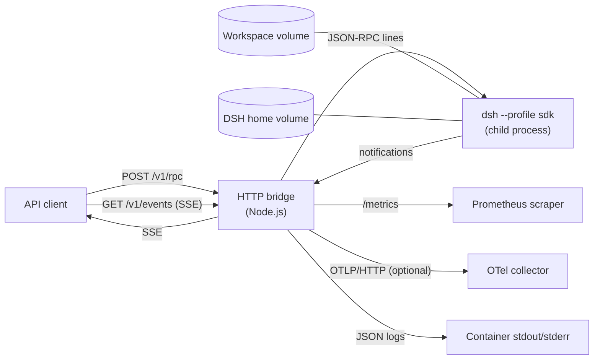

# DSH API Runtime — Implementation Brief

**Status:** ready to implement  
**Target:** a new, standalone repository (not a fork of `deepseek-harness-docker`)  
**Goal:** a small, auditable Docker image that runs DeepSeek Harness as an unauthenticated HTTP API, with HTTP telemetry and a one-command DSH version update flow.

This brief is standalone. Copy it into the new repository (for example as `docs/implementation.md`) and treat §14 as the acceptance contract.

### Requirement map

| Requirement | Where it is specified |
|---|---|
| Everything runs in Docker (build and DSH run) | §4, §6, §10 |
| Configuration through `.eng` | §5 |
| Shell scripts to build and run the image | §10 |
| DSH exposed over HTTP, no authentication | §8, §12.1 |
| Telemetry exposed over HTTP (ideally OpenTelemetry) | §9 |
| Easy DSH updates via version/tag configuration | §11, §10.6 |

---

## 1. Scope and non-goals

### In scope

- Build a container image containing:
  - the official `@deepseek-ai/dsh` npm package, pinned to an exact version;
  - a small HTTP bridge that exposes the DSH SDK runtime over HTTP;
  - OpenTelemetry/Prometheus telemetry over HTTP.
- Run the image with `docker run` or `docker compose`.
- Configure everything from one `.eng` file.
- Build, run, stop, smoke-test, and upgrade with shell scripts.
- Expose DSH **without authentication**.
- Make DSH upgrades a one-line version change plus `scripts/update-dsh.sh`.

### Explicit non-goals

- DSH Web UI, noVNC, Chromium, X11, Browser Use, plugin market, Super Agent.
- `gh`, `pnpm` plugin management, third-party DSH plugins.
- Multi-tenant authentication or authorization.
- Kubernetes manifests (the image must be Kubernetes-friendly, but manifests are out of scope).
- Reimplementing DSH or its SDK protocol.

> **Security warning:** the finished service can execute arbitrary code through DSH tools. “No authentication” means **anyone who can reach the port can run commands in the workspace and spend model credits**. Bind to loopback by default; put it behind a network policy, reverse proxy, or private network if it must be reachable remotely.

---

## 2. Key decisions

| Decision | Choice | Rationale |
|---|---|---|
| DSH surface | `dsh --profile sdk` | The SDK is the API. It speaks newline-delimited JSON-RPC over stdio. |
| HTTP transport | `POST /v1/rpc` + `GET /v1/events` (SSE) | Simple, firewall-friendly, no WebSocket dependency. |
| Process model | one bridge + one DSH child per container | Simplest lifecycle and blast radius; scale with more containers. |
| Bridge language | Node.js 24 ESM, no web framework | Same runtime as DSH; no second toolchain; small dependency set. |
| Initialization | bridge auto-initializes by default | Clients can call `session/prompt` immediately; config comes from `.eng`. |
| Config | flat `.eng` dotenv file | Required by the project; keep it strict and shell-safe. |
| Telemetry | Prometheus `/metrics` + optional OTLP/HTTP push | Pull metrics over HTTP; push traces/metrics/logs if a collector exists. |
| DSH telemetry | disabled by default | Avoid sending product/session telemetry to DeepSeek. |
| Versioning | exact DSH version in `.eng` **and** `package.json` | Reproducible builds; update script keeps both in sync. |
| Auth | none, by requirement | Default bind is `127.0.0.1`; wide bind requires an explicit opt-in flag. |

### Important correction about “HTTP API”

`dsh --profile sdk` is **stdio JSON-RPC**, not HTTP. The bridge is therefore mandatory, not optional. Do not try to expose the DSH Web server as the API; it is a different surface and drags in the Web/browser stack.

---

## 3. Architecture



Two HTTP listeners:

- **API listener** on `HTTP_PORT` (default `8080`): `/v1/rpc`, `/v1/events`, `/v1/status`, `/healthz`, `/readyz`.
- **Telemetry listener** on `TELEMETRY_PORT` (default `9464`): `/metrics`, `/healthz`.

Keeping telemetry on a separate port lets you expose it to a scraper without exposing the API, or vice versa.

---

## 4. Repository layout

```text
dsh-api-runtime/
├── .eng.example
├── .gitignore
├── Dockerfile
├── package.json
├── package-lock.json
├── README.md
├── bridge/
│   ├── server.mjs          # HTTP listeners, routing, lifecycle
│   ├── dsh-child.mjs       # spawn, line framing, restart, shutdown
│   ├── rpc.mjs             # JSON-RPC validation, pending map, timeouts
│   ├── events.mjs          # ring buffer, SSE clients, replay
│   ├── telemetry.mjs       # metrics, traces, OTLP setup
│   └── config.mjs          # env parsing/validation
├── scripts/
│   ├── lib.sh              # strict .eng loader, logging, validation
│   ├── build.sh
│   ├── run.sh
│   ├── stop.sh
│   ├── logs.sh
│   ├── smoke.sh
│   ├── verify.sh
│   └── update-dsh.sh
├── test/
│   ├── fake-dsh.mjs        # deterministic JSON-RPC fixture for CI
│   └── bridge.test.mjs
└── .github/workflows/
    ├── ci.yml
    └── update-dsh.yml
```

No host Node.js/npm is required. Host requirements: Linux (preferred; macOS may need portable `stat`/`readlink` adjustments), Bash 4+, Docker Engine 24+, Docker Buildx, and `git` (for revision labels). All Node/npm work happens in disposable containers.

---

## 5. Configuration: `.eng`

### 5.1 Contract

- `.eng` is a flat, dotenv-style file: `KEY=VALUE`, one per line.
- Blank lines and lines starting with `#` are ignored.
- Values are **literal**. No shell expansion, no command substitution, no `eval`, no `source`.
- Surrounding single or double quotes are stripped.
- Duplicate keys are rejected.
- Keys must match `^[A-Z][A-Z0-9_]*$`.
- `.eng` is git-ignored. `.eng.example` is committed.
- `ENG_FILE=/path/to/file` overrides the default path (CI use).
- `scripts/lib.sh` must refuse to proceed if `.eng` is group/world-readable, unless `ALLOW_INSECURE_ENG=1` is set.

### 5.2 `.eng.example`

```dotenv
# ---------------------------------------------------------------------------
# Build
# ---------------------------------------------------------------------------
IMAGE_REPOSITORY=dsh-api-runtime
IMAGE_TAG=0.2.2-rc.3
DSH_VERSION=0.2.2-rc.3
BRIDGE_VERSION=0.1.0

# Prefer digests for release builds. Get them with:
#   docker buildx imagetools inspect node:24-trixie
#   docker buildx imagetools inspect node:24-trixie-slim
NODE_IMAGE=node:24-trixie
NODE_IMAGE_DIGEST=
RUNTIME_IMAGE=node:24-trixie-slim
RUNTIME_IMAGE_DIGEST=

# ---------------------------------------------------------------------------
# Runtime
# ---------------------------------------------------------------------------
CONTAINER_NAME=dsh-api
# Host ports. The container listeners are fixed at 8080 and 9464.
BIND_ADDRESS=127.0.0.1
HTTP_PORT=8080
TELEMETRY_PORT=9464
ALLOW_UNAUTHENTICATED_EXPOSURE=0

DSH_HOME_VOLUME=dsh-api-home
WORKSPACE_HOST=/srv/dsh-workspace
WORKSPACE=/workspace
DSH_CWD=/workspace

# Provider/model passed to the SDK initialize handshake.
# Replace with a provider/model that is actually configured.
DSH_PROVIDER=deepseek
DSH_MODEL=deepseek-chat
DSH_REASONING_EFFORT=
DSH_MAX_TOKENS=

# Model credentials. Never commit this file.
DEEPSEEK_API_KEY=replace-me

# ---------------------------------------------------------------------------
# Bridge behavior
# ---------------------------------------------------------------------------
AUTO_INITIALIZE=1
INIT_TIMEOUT_MS=60000
RPC_TIMEOUT_MS=300000
MAX_INFLIGHT=16
MAX_BODY_BYTES=8388608
EVENT_BUFFER_COUNT=1000
EVENT_BUFFER_BYTES=5242880
SSE_KEEPALIVE_MS=15000
ENABLE_APPROVALS=0
ENABLE_USER_QUESTIONS=0

# ---------------------------------------------------------------------------
# Telemetry
# ---------------------------------------------------------------------------
LOG_LEVEL=info
LOG_PAYLOADS=0
DSH_TELEMETRY_MODE=DISABLED
OTEL_SERVICE_NAME=dsh-api-runtime
OTEL_EXPORTER_OTLP_ENDPOINT=
OTEL_EXPORTER_OTLP_PROTOCOL=http/protobuf

# ---------------------------------------------------------------------------
# Updates
# ---------------------------------------------------------------------------
UPDATE_CHANNEL=next
```

### 5.3 Required validation

`scripts/lib.sh` must fail with a clear message when:

- `.eng` is missing or unreadable;
- required keys are missing;
- `DSH_VERSION` is not an exact semver;
- `IMAGE_TAG` is not a valid Docker tag (no `+` build metadata, no `/`);
- `NODE_IMAGE` or `RUNTIME_IMAGE` already contains an inline digest (`NODE_IMAGE_DIGEST`/`RUNTIME_IMAGE_DIGEST` are the digest inputs);
- `DSH_VERSION` does not match the `@deepseek-ai/dsh` dependency in `package.json`;
- `HTTP_PORT` or `TELEMETRY_PORT` is invalid or duplicated;
- `BIND_ADDRESS` is non-loopback and `ALLOW_UNAUTHENTICATED_EXPOSURE != 1`;
- no model credential is available;
- `AUTO_INITIALIZE=1` but `DSH_PROVIDER`, `DSH_MODEL`, or `DSH_CWD` is empty.

### 5.4 Runtime environment

`run.sh` must not pass the whole `.eng` file to Docker. Generate a temporary runtime env file containing only:

- `DEEPSEEK_API_KEY` and any provider credentials;
- `DSH_*`;
- `OTEL_*`;
- `LOG_*`;
- `AUTO_INITIALIZE`, `INIT_TIMEOUT_MS`, `RPC_TIMEOUT_MS`, `MAX_INFLIGHT`, `MAX_BODY_BYTES`;
- `EVENT_BUFFER_*`, `SSE_KEEPALIVE_MS`, `ENABLE_APPROVALS`, `ENABLE_USER_QUESTIONS`;
- `WORKSPACE`, `DSH_CWD`.

Delete the temporary file on exit. Never print its contents.

---

## 6. Container image

### 6.1 Dockerfile shape

```dockerfile
# syntax=docker/dockerfile:1.7

# build.sh composes these as "node:24-trixie@sha256:..." when a digest is set.
ARG NODE_IMAGE=node:24-trixie
ARG RUNTIME_IMAGE=node:24-trixie-slim
FROM ${NODE_IMAGE} AS deps

ARG DSH_VERSION
RUN apt-get update \
 && apt-get install --yes --no-install-recommends python3 make g++ \
 && rm -rf /var/lib/apt/lists/*

WORKDIR /app
COPY package.json package-lock.json ./
# Use an explicit lifecycle-script allowlist. Do not blanket-allow all scripts.
# If your npm supports --allow-scripts, use it; otherwise --ignore-scripts and
# rebuild only the packages that genuinely need native/postinstall steps.
RUN npm ci --omit=dev --ignore-scripts \
 && npm rebuild --foreground-scripts node-pty koffi @deepseek-ai/dsh-subprocess-local @google/genai protobufjs \
 && test "$(/app/node_modules/.bin/dsh --version)" = "$DSH_VERSION"

FROM ${RUNTIME_IMAGE}

RUN apt-get update \
 && apt-get install --yes --no-install-recommends \
      ca-certificates \
      git \
      openssh-client \
      ripgrep \
      tini \
      procps \
 && rm -rf /var/lib/apt/lists/*

WORKDIR /app
COPY --from=deps /app/node_modules ./node_modules
COPY package.json ./
COPY bridge ./bridge

ENV NODE_ENV=production \
    HOME=/home/node \
    DSH_HOME=/home/node/.dsh \
    DSH_TELEMETRY_MODE=DISABLED

RUN mkdir -p /home/node/.dsh /workspace \
 && chown -R node:node /home/node /workspace /app

USER node
WORKDIR /workspace
EXPOSE 8080 9464

ARG DSH_VERSION
ARG IMAGE_VERSION=dev
ARG IMAGE_REVISION=unknown
ARG BRIDGE_VERSION=dev
LABEL org.opencontainers.image.title="DSH API Runtime" \
      org.opencontainers.image.version="${IMAGE_VERSION}" \
      org.opencontainers.image.revision="${IMAGE_REVISION}" \
      io.example.dsh.version="${DSH_VERSION}" \
      io.example.bridge.version="${BRIDGE_VERSION}"

HEALTHCHECK --interval=30s --timeout=3s --start-period=20s --retries=3 \
  CMD node -e "fetch('http://127.0.0.1:8080/readyz').then(r => process.exit(r.ok ? 0 : 1)).catch(() => process.exit(1))"

ENTRYPOINT ["/usr/bin/tini", "--", "node", "/app/bridge/server.mjs"]
```

Notes:

- The `deps` stage is disposable; the runtime image must not contain a compiler.
- `package.json` must pin `@deepseek-ai/dsh` exactly and include the pinned OpenTelemetry packages needed by `bridge/telemetry.mjs` (API, metrics SDK, Prometheus exporter, trace SDK, OTLP/HTTP exporters, resources, semantic conventions). `package-lock.json` is the authority for transitive versions.
- `build.sh` is responsible for appending image digests. Pass complete references (`node:24-trixie@sha256:...`) as `NODE_IMAGE` / `RUNTIME_IMAGE` build args; Dockerfile `FROM` must not try to compose digests itself.
- The `@deepseek-ai/dsh` package is installed as a project dependency, not globally. This makes the lockfile authoritative and avoids mutating a global npm tree.
- `node-pty` is the main native dependency. Validate the exact rebuild allowlist against the DSH version you pin.
- Do not install `pnpm` unless you actually need runtime plugin management.
- Do not install Chromium, X11, noVNC, Browser Use, or `gh`.
- Image size will still be roughly 1.5–2 GB because DSH’s own dependency tree is about 1.3 GB. Do not attempt aggressive pruning without an integration test.
- The runtime package list above is deliberately minimal. Add `python3`, `jq`, `less`, `curl`, `file`, `unzip`, or `zip` only if your agent tasks need them; each package widens the attack surface. Verify `libstdc++6` (or the equivalent) is present for `node-pty` with `ldd` on the built image.

### 6.2 Build reproducibility

- Pin `NODE_IMAGE`/`RUNTIME_IMAGE` by digest for release builds.
- Commit `package-lock.json`.
- Build with BuildKit and record:
  - `--sbom=true`
  - `--provenance=mode=max`
- Attestations are meaningful for pushed release images; local `--load` builds may not retain them.
- Optionally sign the image with cosign and scan it with Trivy/Grype in CI.
- Do not publish a floating `latest` tag. Tag by exact DSH version, e.g. `dsh-api-runtime:0.2.2-rc.3`.

### 6.3 Runtime security

Use these flags in `scripts/run.sh`:

```text
--read-only
--tmpfs /tmp:rw,noexec,nosuid,nodev,size=256m
--cap-drop ALL
--security-opt no-new-privileges:true
--pids-limit 512
--user 1000:1000
--stop-timeout 30
```

Mount only:

- `${DSH_HOME_VOLUME}:/home/node/.dsh`
- `${WORKSPACE_HOST}:${WORKSPACE}`

Do not mount the Docker socket. Do not run privileged. Do not use host networking.

---

## 7. DSH child process

### 7.1 Spawn

```text
dsh --profile sdk
```

- Executable: `DSH_BIN`, default `/app/node_modules/.bin/dsh`. The smoke test overrides it with a fixture.
- `cwd`: `DSH_CWD` (normally `/workspace`).
- `HOME`: `/home/node`.
- `DSH_HOME`: `/home/node/.dsh`.
- `DSH_VERSION`: used for `/v1/status` and logs; if absent, read `dsh --version` once at startup.
- `DSH_TELEMETRY_MODE`: `DISABLED` unless explicitly overridden.
- `NO_COLOR=1`, `TERM=dumb`.
- Pass model credentials through the environment.
- `stdio`: pipe stdin/stdout/stderr.

### 7.2 Framing

- One JSON-RPC message per `\n`-terminated line.
- Read stdout with `readline`.
- Ignore malformed lines but log them at `warn` with a bounded preview.
- Write `JSON.stringify(message) + "\n"` to stdin.
- Honor stdin backpressure.
- Consume stderr continuously and forward it to the container’s stderr with a `[dsh]` prefix. Never let a pipe fill and deadlock the child.

### 7.3 Initialization

With `AUTO_INITIALIZE=1`, the bridge sends:

```json
{
  "jsonrpc": "2.0",
  "id": "bridge-init-<uuid>",
  "method": "initialize",
  "params": {
    "cwd": "/workspace",
    "provider": "deepseek",
    "model": "deepseek-chat",
    "approvalRequests": false,
    "capabilities": { "userQuestions": false }
  }
}
```

- `reasoningEffort` and `maxTokens` are included only when set in `.eng`.
- `approvalRequests` is `true` only when `ENABLE_APPROVALS=1`.
- `capabilities.userQuestions` is `true` only when `ENABLE_USER_QUESTIONS=1`.
- `/readyz` returns `200` only after a successful `initialize` response.
- If initialization fails, log the JSON-RPC error and exit nonzero. Do not serve a half-configured runtime.
- With `AUTO_INITIALIZE=0`, `/readyz` returns `200` when the child is alive; the first client must send `initialize`.

> The bridge’s `initialize` is process-wide. Do not auto-initialize and then also accept a client `initialize`; DSH will reject the second handshake. If clients need per-request model selection, use `AUTO_INITIALIZE=0` and one container per model.

### 7.4 Supervision

- `tini` is PID 1; the bridge is PID 2; DSH is a child of the bridge.
- On child exit:
  - reject all pending RPCs with a JSON-RPC error;
  - mark `/readyz` unavailable;
  - restart with exponential backoff: 1s, 2s, 4s, 8s, capped at 30s;
  - re-run initialization when `AUTO_INITIALIZE=1`;
  - after 10 restarts in 5 minutes, exit nonzero so the orchestrator restarts the container.
- On `SIGTERM`/`SIGINT`:
  - stop accepting new HTTP requests;
  - send the DSH `shutdown` request;
  - wait up to 10s for exit;
  - `SIGTERM` the child, wait 5s, then `SIGKILL`;
  - close SSE clients and exit 0.

---

## 8. HTTP API

### 8.1 Endpoints

| Method | Path | Purpose |
|---|---|---|
| `POST` | `/v1/rpc` | Send one JSON-RPC request, notification, or response. |
| `GET` | `/v1/events` | SSE stream of DSH notifications. |
| `GET` | `/v1/status` | Non-secret runtime status. |
| `GET` | `/healthz` | Process liveness. |
| `GET` | `/readyz` | DSH child ready for traffic. |
| `POST` | `/v1/shutdown` | Optional clean shutdown for tests. |
| `GET` | `/metrics` | Prometheus metrics (telemetry listener). |
| `GET` | `/healthz` | Telemetry listener health (telemetry listener). |

No authentication. No CORS by default. Add `CORS_ORIGIN` only if a browser client requires it.

### 8.2 `POST /v1/rpc`

Request body: one JSON object, `Content-Type: application/json`, max `MAX_BODY_BYTES`.

Accepted shapes:

1. **JSON-RPC request** — `jsonrpc`, `id`, `method`, optional `params`.
   - Forward to DSH.
   - Wait for the matching response, up to `RPC_TIMEOUT_MS`.
   - Return the DSH response object with HTTP `200`, even when it is a JSON-RPC error.
2. **JSON-RPC notification** — `jsonrpc`, `method`, no `id`.
   - Forward to DSH.
   - Return HTTP `202` with an empty body.
3. **JSON-RPC response** — `jsonrpc`, `id`, exactly one of `result` or `error`.
   - Forward to DSH, used only when server-to-client requests are enabled.
   - Return HTTP `202`.

Reject batch arrays with `400`.

Error mapping:

| Condition | HTTP | JSON-RPC error |
|---|---:|---|
| Malformed JSON | 400 | `-32700` Parse error |
| Invalid JSON-RPC shape | 400 | `-32600` Invalid Request |
| Body too large | 413 | `-32600` |
| DSH not ready | 503 | `-32000` DSH unavailable |
| Too many in-flight requests | 429 | `-32002` Busy |
| RPC timeout | 504 | `-32001` DSH timeout |
| Bridge internal failure | 500 | `-32603` Internal error |

Example:

```bash
curl -sS http://127.0.0.1:8080/v1/rpc \
  -H 'content-type: application/json' \
  -d '{
    "jsonrpc": "2.0",
    "id": 1,
    "method": "session/prompt",
    "params": {
      "sessionId": "demo",
      "contentBlocks": [{ "type": "text", "text": "List the files in /workspace" }]
    }
  }'
```

`session/prompt` returns only an enqueue receipt, for example:

```json
{"jsonrpc":"2.0","id":1,"result":{"messageId":"..."}}
```

It does **not** return the model’s final answer. Clients must consume `/v1/events` and/or call `session/wait`.

> **Timeouts do not cancel work.** DSH has no cancel method. If an HTTP request times out, the underlying agent work may continue; a `504` means the bridge stopped waiting, not that the run stopped. Use `session/wait` with a generous timeout, or watch `/v1/events` for `session.status: idle`. Do not blindly retry a prompt after a timeout unless you can tolerate duplicate work.

Wait for the session to become idle:

```bash
curl -sS http://127.0.0.1:8080/v1/rpc \
  -H 'content-type: application/json' \
  -d '{"jsonrpc":"2.0","id":2,"method":"session/wait","params":{"sessionId":"demo"}}'
```

### 8.3 `GET /v1/events`

Server-Sent Events stream:

```bash
curl -N http://127.0.0.1:8080/v1/events
```

```text
id: 42
event: rpc
data: {"jsonrpc":"2.0","method":"session.event","params":{"sessionId":"demo","event":{...}}}

```

- Every DSH notification is forwarded verbatim.
- The SSE event name is `rpc`. Browser `EventSource` clients must register `addEventListener("rpc", ...)`; `onmessage` only receives `message` events.
- `id:` is a monotonically increasing sequence number.
- `Last-Event-ID` replays from the ring buffer when possible.
- Keepalive comment every `SSE_KEEPALIVE_MS`:
  ```text
  : ping
  ```
- Optional `?sessionId=` filter. Filtering is best-effort; `subagent.*` notifications may reference multiple sessions.
- Ring buffer is bounded by `EVENT_BUFFER_COUNT` and `EVENT_BUFFER_BYTES`. If a slow client falls behind, close it rather than growing memory without bound.
- Set `Cache-Control: no-cache`, `Connection: keep-alive`, and `X-Accel-Buffering: no`.

Typical client sequence:

1. Open `GET /v1/events`.
2. `POST /v1/rpc` with `session/prompt`.
3. Read `session.event` notifications.
4. Wait for `session.status` with `"status":"idle"` or call `session/wait`.
5. Close the stream.

### 8.4 `GET /v1/status`

Return non-secret state:

```json
{
  "ready": true,
  "dshVersion": "0.2.2-rc.3",
  "serverInfo": { "name": "deepseek-harness-sdk-runtime", "version": "0.0.1" },
  "pid": 123,
  "uptimeMs": 45678,
  "inflight": 1,
  "sseClients": 2,
  "lastExit": null,
  "config": { "provider": "deepseek", "model": "deepseek-chat", "cwd": "/workspace" }
}
```

Never include credentials or prompt content.

### 8.5 JSON-RPC ID handling

- The bridge keys pending requests by `typeof id + ":" + String(id)` to avoid `1` vs `"1"` collisions.
- Reject a client request whose ID is already in flight with HTTP `409` and error `-32600`.
- Preserve the original `id` value in the response.
- Do not reuse bridge-internal IDs for client requests. Bridge IDs use the prefix `bridge-`.

### 8.6 Concurrency and limits

- At most `MAX_INFLIGHT` client requests waiting on DSH.
- Notifications do not count toward the limit.
- Enforce `MAX_BODY_BYTES`.
- Set socket timeouts to avoid slowloris.
- Do not buffer unbounded response bodies.

---

## 9. Telemetry

### 9.1 What “exposes telemetry via HTTP” means here

OpenTelemetry is primarily **push**-oriented. To expose telemetry over HTTP in a pull model, use Prometheus. This design does both:

- **Pull:** `GET /metrics` on `TELEMETRY_PORT` in Prometheus text format.
- **Push:** if `OTEL_EXPORTER_OTLP_ENDPOINT` is set, export traces, metrics, and logs over OTLP/HTTP.

Do not invent a custom “OTLP pull” endpoint; it is not standard.

Telemetry scope:

- The bridge instruments its own HTTP/RPC boundary and process lifecycle.
- It can derive session-level counters/events from DSH notifications (`session.status`, `subagent.*`, `session.query.completed`).
- It does **not** scrape DSH internals. Token/cost metrics are available only if the notification payloads actually expose usage; do not promise them blindly.
- DSH’s native OTel telemetry is a separate upstream feature. Keep it disabled unless the operator deliberately enables it.

### 9.2 Metrics

Required metrics:

| Metric | Type | Labels |
|---|---|---|
| `dsh_bridge_http_requests_total` | counter | `method`, `route`, `status` |
| `dsh_bridge_http_request_duration_seconds` | histogram | `method`, `route` |
| `dsh_bridge_rpc_requests_total` | counter | `method`, `status` |
| `dsh_bridge_rpc_request_duration_seconds` | histogram | `method` |
| `dsh_bridge_rpc_inflight` | gauge | — |
| `dsh_bridge_sse_clients` | gauge | — |
| `dsh_bridge_events_total` | counter | `method` |
| `dsh_bridge_dsh_up` | gauge | — |
| `dsh_bridge_dsh_restarts_total` | counter | — |
| `dsh_bridge_process_resident_memory_bytes` | gauge | — |

Add runtime/default Node metrics only if they are cheap and stable.

Do **not** use session IDs, request IDs, or raw URL paths as metric labels: they are unbounded and can leak tenant identifiers. Use templated routes such as `/v1/rpc`, `/v1/events`, and `/v1/status`. Session IDs belong in traces/logs, not metrics.

Serve `/metrics` from the telemetry listener using the Prometheus exporter’s request handler (`startServer: false`) so the process owns one HTTP listener and one shutdown path.

### 9.3 Traces

Create manual spans; do not add OpenTelemetry auto-instrumentation just for HTTP:

- `http.server.request` — HTTP method, route, status code, duration.
- `dsh.rpc` — `rpc.system=jsonrpc`, `rpc.method`, `dsh.request.id`, `dsh.session.id` (when known), `error.type`.
- `dsh.child.start` / `dsh.child.stop` — process lifecycle.
- `dsh.event` — one short span or span event for `session.status`, `subagent.*`, and `session.query.completed`.

Do not put prompt text, assistant text, or full `session.event` payloads in span attributes by default.

### 9.4 Logs

- JSON lines to stdout/stderr.
- Include `ts`, `level`, `msg`, `request_id`, `rpc_id`, `method`, `session_id`, `duration_ms`, `status`.
- Never log API keys, authorization headers, prompt content, or tool output.
- `LOG_PAYLOADS=0` by default. If enabled, document the privacy risk and cap payload length.
- Forward DSH stderr with a `[dsh]` prefix.

### 9.5 DSH’s own telemetry

- Set `DSH_TELEMETRY_MODE=DISABLED` by default.
- DSH’s native product/session telemetry is separate from this bridge and may send data to DeepSeek. Enabling it is an explicit operator decision; review upstream documentation first.
- Do not conflate DSH’s `serverInfo.version` (`0.0.1`, the wire protocol identity) with the DSH package version.

---

## 10. Shell scripts

### 10.1 `scripts/lib.sh`

Shared functions:

- `load_eng` — strict parser described in §5.
- `require_cmd` — check `docker` and `docker buildx`.
- `die`, `warn`, `info`.
- `is_loopback` — validate `BIND_ADDRESS`.
- `runtime_env_file` — generate the filtered temp env file.
- `require_image` — check the image exists.

### 10.2 `scripts/build.sh`

```bash
#!/usr/bin/env bash
set -Eeuo pipefail
# load .eng, validate versions, then:
NODE_IMAGE_REF="${NODE_IMAGE}${NODE_IMAGE_DIGEST:+@${NODE_IMAGE_DIGEST}}"
RUNTIME_IMAGE_REF="${RUNTIME_IMAGE}${RUNTIME_IMAGE_DIGEST:+@${RUNTIME_IMAGE_DIGEST}}"

docker buildx build \
  --pull \
  --build-arg DSH_VERSION="$DSH_VERSION" \
  --build-arg IMAGE_VERSION="$IMAGE_TAG" \
  --build-arg IMAGE_REVISION="$(git describe --always --dirty 2>/dev/null || echo unknown)" \
  --build-arg BRIDGE_VERSION="$BRIDGE_VERSION" \
  --build-arg NODE_IMAGE="$NODE_IMAGE_REF" \
  --build-arg RUNTIME_IMAGE="$RUNTIME_IMAGE_REF" \
  --tag "${IMAGE_REPOSITORY}:${IMAGE_TAG}" \
  --load .
```

Requirements:

- Default `IMAGE_TAG` to `$DSH_VERSION` when it is empty.
- Fail if `.eng` `DSH_VERSION` does not match `package.json`.
- Fail if `package-lock.json` is missing.
- Optionally add `--sbom=true --provenance=mode=max` for release builds.
- Verify the result:
  ```bash
  docker run --rm --entrypoint /app/node_modules/.bin/dsh \
    "${IMAGE_REPOSITORY}:${IMAGE_TAG}" --version
  ```
- Do not tag `latest` automatically.

### 10.3 `scripts/run.sh`

Behavior:

- Load and validate `.eng`.
- Build if the image is missing, unless `--no-build`.
- Create the DSH home volume if missing.
- Generate the filtered runtime env file.
- Run:

```bash
docker run \
  --name "$CONTAINER_NAME" \
  --read-only \
  --tmpfs /tmp:rw,noexec,nosuid,nodev,size=256m \
  --tmpfs /home/node/.cache:rw,noexec,nosuid,nodev,size=128m,mode=0700,uid=1000,gid=1000 \
  --tmpfs /home/node/.npm:rw,noexec,nosuid,nodev,size=128m,mode=0700,uid=1000,gid=1000 \
  --cap-drop ALL \
  --security-opt no-new-privileges:true \
  --pids-limit 512 \
  --user 1000:1000 \
  --stop-timeout 30 \
  -p "${BIND_ADDRESS}:${HTTP_PORT}:8080" \
  -p "${BIND_ADDRESS}:${TELEMETRY_PORT}:9464" \
  -v "${DSH_HOME_VOLUME}:/home/node/.dsh" \
  -v "${WORKSPACE_HOST}:${WORKSPACE}" \
  --env-file "$RUNTIME_ENV_FILE" \
  "${IMAGE_REPOSITORY}:${IMAGE_TAG}"
```

- Default: foreground plus `--rm`, so `Ctrl-C` stops and removes it.
- `-d`: detached with `--restart unless-stopped` **and without `--rm`** (`docker run` rejects combining them).
- Add `--memory`/`--cpus` limits appropriate for the host; they are not shown to keep the example readable.
- The runtime env file must contain raw `KEY=VALUE` lines, no quotes and no newlines in values.
- IPv6 bind addresses need bracket syntax; the default example is IPv4 loopback.
- Print:
  - API base URL;
  - telemetry URL;
  - note that there is no authentication.
- Refuse a non-loopback `BIND_ADDRESS` unless `ALLOW_UNAUTHENTICATED_EXPOSURE=1`.
- If `WORKSPACE_HOST` is owned by a UID other than 1000, tell the operator to fix ownership or pass `--user`.

### 10.4 `scripts/stop.sh`, `scripts/logs.sh`

- `stop.sh`: `docker stop "$CONTAINER_NAME"`; do not delete volumes.
- `logs.sh`: `docker logs -f --tail 200 "$CONTAINER_NAME"`.

### 10.5 `scripts/smoke.sh`

Two layers:

1. **Fake-DSH integration test (always runs in CI).**
   - Mount the fixture read-only and point the bridge at it:
     ```bash
     -v "$PWD/test:/test:ro" -e DSH_BIN=/test/fake-dsh.mjs
     ```
   - The fixture responds to `initialize`, `session/prompt`, `session/wait`, `shutdown`, and emits `session.status` / `session.event`.
   - Assert:
     - `/readyz` becomes 200;
     - `POST /v1/rpc` initialize/prompt works;
     - SSE receives the expected notification;
     - `/metrics` contains the required metric names.
2. **Live smoke (opt-in, costs model credits).**
   - Require `RUN_LIVE_SMOKE=1` and a configured key.
   - Send a prompt such as “Reply with the single word OK”.
   - Wait for idle, assert a non-empty assistant result, then stop.

`DSH_BIN` must be configurable so tests never need a real model.

### 10.6 `scripts/update-dsh.sh`

```bash
scripts/update-dsh.sh next
scripts/update-dsh.sh latest
scripts/update-dsh.sh 0.2.2-rc.3
```

Steps:

1. Resolve the requested channel to an exact version:
   ```bash
   docker run --rm node:24-trixie \
     npm view "@deepseek-ai/dsh@${channel}" version
   ```
2. Refuse to continue if the version is unchanged.
3. Update `.eng` `DSH_VERSION` and `IMAGE_TAG`.
4. Update `package.json`’s exact `@deepseek-ai/dsh` dependency.
5. Regenerate `package-lock.json` in a disposable Node container running as the host UID:
   ```bash
   docker run --rm -v "$PWD":/src -w /src --user "$(id -u):$(id -g)" \
     node:24-trixie npm install --package-lock-only --ignore-scripts
   ```
6. Run `scripts/build.sh` and `scripts/smoke.sh`.
7. Print the diff and the rollback tag. Do **not** auto-commit.
8. In CI, open a PR with the version, lockfile, and test result.

### 10.7 `scripts/verify.sh`

Assert:

- `.eng` `DSH_VERSION` == `package.json` dependency.
- `package-lock.json` exists and is consistent (`npm ci --dry-run` in a container).
- Image label `io.example.dsh.version` matches `.eng`.
- `docker run ... dsh --version` matches.
- No `latest` tag is produced.

---

## 11. Versioning and upgrades

- `DSH_VERSION` is always an exact version. Do not build from a floating tag in production.
- `UPDATE_CHANNEL` is used only by `scripts/update-dsh.sh` (`next`, `latest`, `alpha`, or `none`).
- Default to `next`: DSH is a prerelease and the npm `latest` tag can lag behind. At the time of writing, `@deepseek-ai/dsh@latest` resolves to `0.2.2-rc.1` while `next` resolves to `0.2.2-rc.3`.
- Keep at least the previous image tag for rollback.
- Back up the `DSH_HOME` volume before an upgrade. DSH session storage can change between prereleases.
- After an upgrade:
  1. run the fake-DSH smoke test;
  2. run the live smoke test if credentials are available;
  3. verify `/v1/status` reports the new DSH version;
  4. check that the SDK protocol still exposes the methods you depend on.
- Add a scheduled CI job (daily or weekly) that runs `scripts/update-dsh.sh` in a branch and opens a PR when a new version exists.

---

## 12. Security model

### 12.1 No authentication

This is a deliberate requirement and the largest risk:

- Anyone with network access can execute agent tools in the workspace.
- Anyone with network access can consume model credits.
- There is no per-user isolation inside one container.

Mitigations:

- Default `BIND_ADDRESS=127.0.0.1`.
- Refuse `0.0.0.0`/`::` unless `ALLOW_UNAUTHENTICATED_EXPOSURE=1`.
- Document that a reverse proxy with auth, mTLS, or a private network is mandatory for remote access.
- Apply CPU/memory/pids limits at the container runtime.
- Use a dedicated workspace volume, not a broad host mount.
- Consider gVisor/Kata/Firecracker if the workload is untrusted.
- The telemetry listener is unauthenticated too. Expose `/metrics` only to trusted scrapers or a private monitoring network.

### 12.2 Secrets

- `.eng` contains model credentials. Mode `0600`, git-ignored, never baked into the image.
- `docker inspect` exposes environment variables to anyone with Docker access; restrict Docker access.
- Never log credentials or request headers.
- Rotate keys if `.eng` is leaked.

### 12.3 Supply chain

- Pin base images by digest.
- Commit `package-lock.json`; build with `npm ci`.
- Use an explicit lifecycle-script allowlist.
- Run `npm audit signatures` in CI. Registry signatures prove the tarball matches what npm signed; they do not prove publisher intent. No npm provenance attestation was available for `0.2.2-rc.3`, so treat the DeepSeek npm publisher account as a trust anchor.
- Generate an SBOM and provenance; sign the image.
- Scan the image before publishing.
- Pin CI actions by SHA.
- Prefer vendoring the DSH tarball into your own artifact store if registry availability is a concern.

---

## 13. Testing and CI

### 13.1 Test layers

1. **Unit tests**
   - `.eng` parser (quotes, comments, duplicates, rejection of unsafe syntax).
   - JSON-RPC shape validation and error mapping.
   - Pending-ID collision handling.
   - Ring buffer bounds and SSE framing.
2. **Integration tests with fake DSH**
   - No model calls; deterministic.
   - Covers startup, auto-init, RPC, SSE, metrics, shutdown, and restart.
3. **Live smoke (optional)**
   - Requires credentials; run manually or in a protected CI job.
4. **Container tests**
   - Non-root UID.
   - Read-only root filesystem.
   - `/readyz` behavior.
   - `/metrics` presence.
   - Image label/version assertions.

### 13.2 CI workflow

On pull request:

- `npm ci` / lockfile check.
- unit + fake-DSH integration tests.
- `scripts/build.sh`.
- Trivy/Grype scan.
- Verify non-root/read-only flags in the run script.
- `actionlint`/shellcheck (optional but recommended).

On tag/release:

- `docker buildx build --platform linux/amd64,linux/arm64`.
- `--sbom=true --provenance=mode=max`.
- cosign sign.
- Push to your registry.
- Keep the previous tag.

### 13.3 Scheduled update workflow

- Run daily/weekly.
- Resolve the latest `next` (or configured channel).
- If changed, run `scripts/update-dsh.sh`, build, fake smoke.
- Open a PR. Do not auto-merge.

---

## 14. Acceptance criteria

The implementation is done when all of the following are true:

- [ ] `scripts/build.sh` builds a multi-stage image from a clean checkout without host Node.js.
- [ ] `scripts/run.sh` starts the container using only `.eng`; no secrets are baked into the image.
- [ ] The API listens on `HTTP_PORT`; the telemetry listener on `TELEMETRY_PORT`.
- [ ] `POST /v1/rpc` with `session/prompt` returns an enqueue receipt.
- [ ] `GET /v1/events` streams `session.event` and `session.status` notifications.
- [ ] `GET /readyz` returns 200 only after a successful auto-initialize.
- [ ] `GET /metrics` returns the required Prometheus metrics.
- [ ] OTLP/HTTP export works when `OTEL_EXPORTER_OTLP_ENDPOINT` is set.
- [ ] `DSH_TELEMETRY_MODE=DISABLED` is the default.
- [ ] The container runs as non-root, with a read-only root, dropped capabilities, and no Docker socket.
- [ ] `scripts/update-dsh.sh next` updates `.eng`, `package.json`, and `package-lock.json`, then builds and passes the fake smoke test.
- [ ] `dsh --version` and the image label match `.eng`.
- [ ] No `latest` tag is published automatically.
- [ ] A live smoke test succeeds with a real model when explicitly enabled.
- [ ] `README.md` documents the no-auth risk, default loopback bind, rollback, and volume backup.

---

## 15. Suggested implementation order

1. **Day 1 — skeleton**
   - Dockerfile, `package.json`/lockfile, bridge that spawns `dsh --profile sdk`, `/healthz`, `/readyz`, `/v1/rpc` request/response.
   - Fake-DSH fixture and one integration test.
2. **Day 2 — streaming and config**
   - `/v1/events` SSE, ring buffer, notification forwarding.
   - `.eng` loader, build/run scripts, auto-initialize, process supervision.
3. **Day 3 — telemetry and hardening**
   - `/metrics`, OTel traces, structured logs.
   - Read-only/non-root/cap-drop run flags, secret handling, validation.
4. **Day 4–5 — release engineering**
   - Multiarch CI, SBOM/provenance/signing, image scanning, version-update workflow, README.
   - Live smoke test.

If an HTTP/WebSocket API for browser clients is later required, add a WebSocket transport as a second adapter; keep the JSON-RPC core unchanged.

---

## 16. Open questions to settle before coding

1. Is `dsh --profile sdk` definitely the required API, or is `headless --json` also needed?
2. Is one DSH process per container enough, or do you need one process per tenant/session?
3. What are the real provider/model identifiers and credential env vars?
4. Do clients need server-to-client approvals or user questions? If yes, enable SSE + `/v1/rpc` responses deliberately.
5. Is POST + SSE acceptable, or must browser clients use WebSocket?
6. Is Prometheus scraping sufficient, or is an OTLP collector mandatory?
7. Should the workspace be a host bind mount or a named volume?
8. What is the maximum acceptable image size and cold-start time?
9. What DSH permission/approval policy should the SDK profile use? The `initialize` handshake only toggles `approvalRequests`; tool permissions are configured elsewhere in the profile.
10. Which network/CIDR may reach the unauthenticated API, and who owns the reverse proxy or network policy?

---

## 17. Reference points in the existing wrapper

These are useful examples, not code to copy wholesale:

- [Dockerfile](../Dockerfile) — multi-stage install and version assertions.
- [compose.yaml](../compose.yaml) — non-root, read-only, capability-drop patterns.
- [scripts/smoke.sh](../scripts/smoke.sh) — runtime contract checks.
- [scripts/check-version-consistency.sh](../scripts/check-version-consistency.sh) — version consistency checks.

Do **not** carry over the Web/desktop, Chromium, noVNC, Browser Use, market, Super Agent, or third-party browser plugin parts. They are unrelated to this service.
